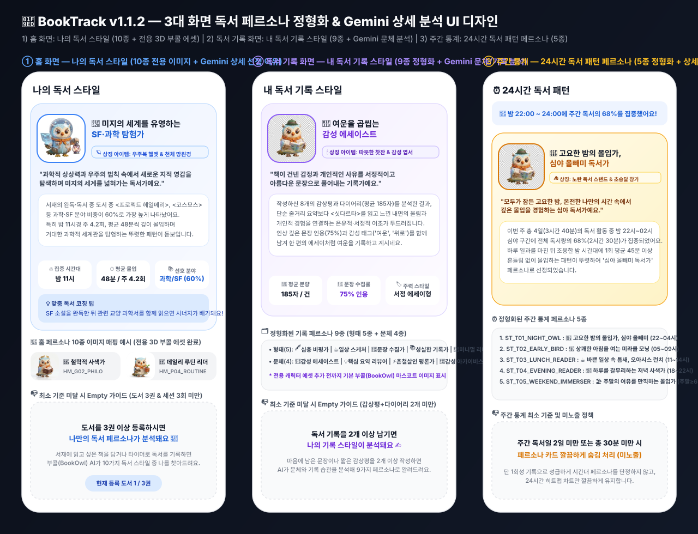
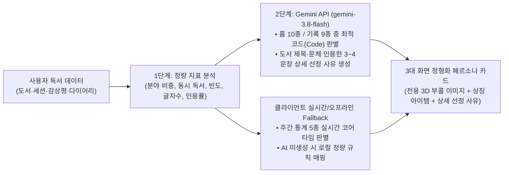

# 🧭 BookTrack 3대 화면별 독서 페르소나 및 캐릭터 사전 구축 기획서 (v1.1.2)

> **목적**: 사용자의 독서 행동 패턴, 선호 장르, 기록 스타일, 집중 시간대를 정밀하게 분석하여 개인화된 독서 페르소나를 부여하고, 북트랙의 마스코트 캐릭터 **'부콜(bookowl)'**와 함께 독서 동기부여와 성취감을 극대화합니다.

---

## 📌 목차
1. [핵심 설계 원칙 & Empty UI 정책](#1-핵심-설계-원칙--empty-ui-정책)
2. [1. 홈 화면: 독서 스타일 & 성향 페르소나 (10종)](#2-1-홈-화면-독서-스타일--성향-페르소나-10종)
3. [2. 독서 기록(스크랩북) 화면: 기록 스타일 & 문체 페르소나 (9종)](#3-2-독서-기록스크랩북-화면-기록-스타일--문체-페르소나-9종)
4. [3. 통계(주간) 화면: 독서 패턴 & 코어 타임 페르소나 (5종)](#4-3-통계주간-화면-독서-패턴--코어-타임-페르소나-5종)
5. [북트랙 마스코트 '부콜(bookowl)' 캐릭터 에셋 구축 방안](#5-북트랙-마스코트-부콜bookowl-캐릭터-에셋-구축-방안)
6. [클라우드 기반 페르소나 메타데이터 & 에셋 아키텍처 (Firestore & Storage)](#6-클라우드-기반-페르소나-메타데이터--에셋-아키텍처-firestore--storage)
7. [3대 화면 독서 페르소나 표시 개편 디자인 시안 & 구현 아키텍처 (v1.1.2)](#7-3대-화면-독서-페르소나-표시-개편-디자인-시안--구현-아키텍처-v112)

---

## 1. 핵심 설계 원칙 & Empty UI 정책

1. **정직한 데이터 기반 페르소나**:
   - 가짜 디폴트 데이터(예: 무조건 '독서 탐험가' 노출)는 절대 사용하지 않습니다.
   - 유저의 실측 데이터가 분석 기준을 충족했을 때만 페르소나를 활성화합니다.
2. **화면별 Empty 상태 가이드**:
   - **홈 화면**: 등록 도서 3권 미만 시 ➔ *"도서를 3권 이상 등록하시면 나만의 독서 페르소나가 분석돼요 🧭"*
   - **독서 기록 화면**: 기록 2개 미만 시 ➔ *"독서 기록을 2개 이상 남기면 나의 기록 스타일이 분석돼요 ✍️"* (공백 노출 금지)
   - **통계(주간) 화면**: 해당 주 독서 기록 2일 미만 시 ➔ 페르소나 영역 완전 미노출 (불필요한 공백/가짜 데이터 제거)

---

## 2. 1) 홈 화면: 독서 스타일 & 성향 페르소나 (10종)

### 📊 분석 알고리즘
- **입력 데이터**: 유저 서재에 등록된 도서의 카테고리(장르) 분포, 현재 읽는 책 권수(병렬 여부), 독서 세션 빈도 및 세션당 시간.
- **최소 분석 기준**: 서재 등록 도서 **3권 이상** 또는 완료된 독서 세션 **3회 이상**.

### 🌟 페르소나 유형 정의

#### A. 장르 중심 페르소나 (6종)
| 페르소나 코드 (`id`) | 페르소나 명칭 | 대표 장르 | 성향 설명 | 부콜 캐릭터 아이템 | 이미지 파일명 |
| :--- | :--- | :--- | :--- | :--- | :--- |
| `HM_G01_SF_EXPLORER` | **🌌 경계를 넘는 SF 탐험가** | 과학, SF, 미래기술 | 상상력의 한계를 시험하고 미지의 세계를 탐험하는 독서가 | 우주 헬멧 + 별빛 랜턴 | `HM_G01_SF_EXPLORER.jpg` |
| `HM_G02_PHILO_THINKER` | **🏛️ 지혜를 좇는 철학적 사색가** | 인문, 철학, 심리학 | 인간과 세계의 본질을 깊이 고민하고 통찰을 얻는 독서가 | 그리스식 월계관 + 둥근 안경 | `HM_G02_PHILO_THINKER.jpg` |
| `HM_G03_HISTORY_EXPLORER` | **⏳ 시대의 목격자, 역사 탐방가** | 역사, 문화, 고전 | 과거의 숨결을 느끼며 거대한 시간의 흐름을 조망하는 독서가 | 나침반 + 양장 가죽 지도 | `HM_G03_HISTORY_EXPLORER.jpg` |
| `HM_G04_LITERATURE_LOVER` | **📖 감성 어린 문학 애호가** | 소설, 시, 수필 | 언어의 아름다움과 인물의 감정선에 흠뻑 몰입하는 독서가 | 깃펜 + 따뜻한 머그컵 | `HM_G04_LITERATURE_LOVER.jpg` |
| `HM_G05_GROWTH_STRATEGIST` | **💡 성장과 돌파의 전략가** | 자기계발, 경제/경영 | 실질적인 지식과 인사이트를 실천으로 전환하는 독서가 | 스마트 워치 + 반짝이는 전구 핀 | `HM_G05_GROWTH_STRATEGIST.jpg` |
| `HM_G06_ART_WALKER` | **🎨 영감을 모으는 예술 산책자** | 예술, 건축, 디자인 | 시각적 미학과 창작의 에너지를 도서에서 발견하는 독서가 | 팔레트 베레모 + 스케치북 | `HM_G06_ART_WALKER.jpg` |

#### B. 독서 성향 & 패턴 중심 페르소나 (4종, 신규 반영)
| 페르소나 코드 (`id`) | 페르소나 명칭 | 분석 조건 | 성향 설명 | 부콜 캐릭터 아이템 | 이미지 파일명 |
| :--- | :--- | :--- | :--- | :--- | :--- |
| `HM_P01_ALL_ROUNDER` | **🌈 경계를 넘나드는 잡식성 올라운더** | 상위 3개 카테고리 비중이 각각 35% 미만으로 고른 분포 | 장르를 가리지 않고 모든 지식과 이야기를 흥미롭게 흡수 | 무지개 머플러 + 배낭 가득 꽂힌 책들 | `HM_P01_ALL_ROUNDER.jpg` |
| `HM_P02_PARALLEL_READER` | **📚 여러 세상을 넘나드는 병렬 독서가** | '지금 읽는 중' 상태의 도서가 **3권 이상** | 그날의 기분과 상황에 따라 여러 책을 번갈아 읽는 멀티태스커 | 3단으로 높이 쌓인 책 탑 위에 앉은 부콜 | `HM_P02_PARALLEL_READER.jpg` |
| `HM_P03_STUDY_LEADER` | **🎓 깊이를 파고드는 학구파 스터디 리더** | 전문/수험/학술 도서 비중이 높고 형광펜/메모 세션 위주 | 한 줄 한 줄 정독하며 완벽히 내 것으로 체화하는 공부형 독서가 | 학사모 + 두꺼운 백과사전 | `HM_P03_STUDY_LEADER.jpg` |
| `HM_P04_DAILY_ROUTINE` | **🌱 틈틈이 피어나는 데일리 루틴 리더** | 최근 7일 중 5일 이상 매일 10~30분씩 꾸준한 독서 | 거창하지 않아도 매일 독서의 씨앗을 성실히 심어가는 습관가 | 새싹 핀 화분 + 조그만 포켓북 | `HM_P04_DAILY_ROUTINE.jpg` |

---

## 3. 2) 독서 기록(스크랩북) 화면: 기록 스타일 & 문체 페르소나 (9종)

### 📊 분석 알고리즘
- **입력 데이터**: 감상평(Review) 글자 수, 다이어리(Diary) 작성 빈도, 구절 스크랩 수, 평점 등록률, 템플릿/테마 사용 패턴.
- **최소 분석 기준**: 감상평 또는 다이어리 누적 **2개 이상** 작성.
- **미달 시 처리**: 공백 표시 금지 ➔ *"독서 기록을 2개 이상 남기면 나의 기록 스타일이 분석돼요 ✍️"* 가이드 카드 표출.

### 🌟 페르소나 유형 정의

#### A. 기록 포맷 & 빈도 중심 (5종)
| 페르소나 코드 (`id`) | 페르소나 명칭 | 판정 조건 | 스타일 설명 | 부콜 캐릭터 아이템 | 이미지 파일명 |
| :--- | :--- | :--- | :--- | :--- | :--- |
| `RC_F01_DEEP_CRITIC` | **🖋️ 깊이를 새기는 심층 비평가** | 리뷰 평균 300자 이상, 완독 대비 리뷰 작성률 70% 이상 | 책 한 권을 완전히 해체하고 재구성하는 본격 서평가 | 고급 잉크병 + 만년필 | `RC_F01_DEEP_CRITIC.jpg` |
| `RC_F02_DAILY_SKETCHER` | **📸 순간을 포착하는 일상 스케처** | 다이어리 비중 70% 이상, 주 3회 이상 단문 메모 | 책을 읽으며 스친 찰나의 감정과 생각을 스케치하듯 남김 | 빈티지 목걸이 카메라 | `RC_F02_DAILY_SKETCHER.jpg` |
| `RC_F03_SENTENCE_COLLECTOR` | **✨ 빛나는 문장 수집가** | 책 속 인용구/구절 스크랩 비중이 가장 높음 | 마음을 울린 한 문장을 보석처럼 찾아내 수집하는 큐레이터 | 돋보기 + 반짝이는 별빛 유리병 | `RC_F03_SENTENCE_COLLECTOR.jpg` |
| `RC_F04_DILIGENT_ARCHIVIST` | **🗂️ 완벽을 기하는 성실한 아키비스트** | 완독 도서 100%에 별점과 감상평이 빠짐없이 채워짐 | 한 권의 완독도 누락 없이 완벽한 서재 데이터베이스를 구축 | 체계적인 인덱스 라벨 스크랩북 | `RC_F04_DILIGENT_ARCHIVIST.jpg` |
| `RC_F05_MINIMAL_READER` | **🕊️ 여백을 즐기는 미니멀 리더** | 평점 위주 또는 50자 이내의 담백한 키워드 기록 | 군더더기 없이 꼭 필요한 한마디만 정갈하게 남기는 여백의 미학 | 심플한 화이트 노트 + 연필 한 자루 | `RC_F05_MINIMAL_READER.jpg` |

#### B. 문체 & 테마 중심 (4종, 신규 반영)
| 페르소나 코드 (`id`) | 페르소나 명칭 | 판정 조건 | 스타일 설명 | 부콜 캐릭터 아이템 | 이미지 파일명 |
| :--- | :--- | :--- | :--- | :--- | :--- |
| `RC_S01_LYRICAL_ESSAYIST` | **🕯️ 사색을 빚는 서정적 에세이스트** | '마음', '계절', '시간' 등 감성 어휘 및 명조체/따뜻한 템플릿 사용 | 책과 자신의 인생 경험을 감미로운 에세이처럼 엮어냄 | 은은하게 켜진 캔들 + 누런 양장 노트 | `RC_S01_LYRICAL_ESSAYIST.jpg` |
| `RC_S02_SMART_CRITIC` | **🔍 논리와 통찰의 스마트 크리틱** | '왜냐하면', '결론', '관점' 등 논리적 전개 및 고딕체/다크 템플릿 | 저자의 논지를 객관적으로 검증하고 새로운 시각을 제시 | 핀마이크 + 클립보드 | `RC_S02_SMART_CRITIC.jpg` |
| `RC_S03_ONE_LINE_CRITIC` | **⚡️ 임팩트 중심의 한 줄 평론가** | 핵심을 찌르는 1~2문장의 강렬한 단문 위주 기록 | 긴 서술 대신 촌철살인의 강렬한 메시지로 책을 정의함 | 전광판 네온 펜 | `RC_S03_ONE_LINE_CRITIC.jpg` |
| `RC_S04_ARTISTIC_LOGGER` | **🎨 감성을 디자인하는 아티스틱 로거** | 다양한 배경 컬러, 스티커, 감성 템플릿을 적극 활용 | 활자뿐 아니라 시각적인 분위기와 감성까지 함께 디자인 | 컬러풀한 마스킹 테이프 + 스티커 팩 | `RC_S04_ARTISTIC_LOGGER.jpg` |

---

## 4. 3) 통계(주간) 화면: 독서 패턴 & 코어 타임 페르소나 (5종)

### 📊 분석 알고리즘
- **입력 데이터**: 주간 독서 세션들의 시작 시각(0~23시) 및 요일(평일 vs 주말) 비중.
- **최소 분석 기준**: 해당 주간에 **최소 2일 이상**, 총합 **30분 이상**의 타이머 세션 기록.
- **미달 시 처리**: 가짜 디폴트 데이터 노출 금지 ➔ 페르소나 카드 완전 숨김 처리.

### 🌟 페르소나 유형 정의
| 페르소나 코드 (`id`) | 페르소나 명칭 | 집중 시간대 / 조건 | 패턴 설명 | 부콜 캐릭터 아이템 | 이미지 파일명 |
| :--- | :--- | :--- | :--- | :--- | :--- |
| `ST_T01_NIGHT_OWL` | **🦉 밤의 고요를 밝히는 올빼미 독서가** | 심야 **22:00 ~ 03:00** 비중 60% 이상 | 모두가 잠든 고요한 밤, 혼자만의 온전한 몰입을 즐기는 야행성 독서가 | 초승달 수면 모자 + 올빼미 램프 | `ST_T01_NIGHT_OWL.jpg` |
| `ST_T02_EARLY_BIRD` | **🌅 새벽을 깨우는 얼리버드 리더** | 이른 아침 **05:00 ~ 09:00** 비중 60% 이상 | 하루의 시작을 맑은 정신과 활자로 깨우는 미라클 모닝 독서가 | 모닝 커피잔 + 붉은 태양 배지 | `ST_T02_EARLY_BIRD.jpg` |
| `ST_T03_LUNCH_READER` | **🥪 틈새를 채우는 런치 리더** | 낮 **11:30 ~ 13:30** 비중 50% 이상 | 바쁜 일상 속 점심시간 틈새를 놓치지 않고 충전하는 스마트 리더 | 귀여운 샌드위치 + 미니 타이머 | `ST_T03_LUNCH_READER.jpg` |
| `ST_T04_EVENING_READER` | **🌇 하루를 정리하는 이브닝 리더** | 저녁 **18:00 ~ 21:00** 비중 60% 이상 | 퇴근/하교 후 지친 하루를 활자로 치유하고 정리하는 저녁의 독서가 | 노을빛 스탠드 조명 + 담요 | `ST_T04_EVENING_READER.jpg` |
| `ST_T05_WEEKEND_IMMERSER` | **⛺️ 주말을 불태우는 위켄드 몰입가** | 토/일 주말 독서 시간 비중 **70% 이상** | 평일엔 에너지를 아끼다 주말에 몰아서 긴 호흡으로 완독하는 몰입형 | 캠핑 텐트 + 커다란 모래시계 | `ST_T05_WEEKEND_IMMERSER.jpg` |

---

## 5. 북트랙 마스코트 '부콜(bookowl)' 캐릭터 에셋 구축 방안

1. **캐릭터 기본 외형**:
   - 책장을 덮은 듯한 아기자기한 외투를 입은 호기심 많은 올빼미/도깨비 형태의 3D 클레이 스타일 마스코트.
   - 기본 마스코트 코드: `MASCOT_DEFAULT` (`MASCOT_DEFAULT.png` / `MASCOT_DEFAULT.jpg`)
2. **페르소나 코드 부여 체계 (`{화면코드}_{분류코드}{순번}_{영문식별자}`)**:
   - **홈 화면 (`HM`)**: 장르 중심 `HM_G01` ~ `HM_G06`, 독서 성향/패턴 중심 `HM_P01` ~ `HM_P04`
   - **독서 기록 화면 (`RC`)**: 포맷/빈도 중심 `RC_F01` ~ `RC_F05`, 문체/테마 중심 `RC_S01` ~ `RC_S04`
   - **통계 화면 (`ST`)**: 코어 타임/패턴 중심 `ST_T01` ~ `ST_T05`
3. **에셋 파이프라인**:
   - `core/designsystem/character/` 리소스 디렉토리 신설.
   - 각 페르소나 코드에 1:1 매칭되는 24개 테마의 일러스트(`{personaCode}.webp` / `.jpg`) 생성.
4. **Compose Multiplatform 연동**:
   - `PersonaView` 공통 컴포넌트에서 분석 결과 코드(`HM_G01_SF_EXPLORER`, `ST_T01_NIGHT_OWL` 등)에 따라 해당 캐릭터 리소스를 로드.

추가 및 수정 사항:
1. 마스코트 이미지는 어디서든 사용할 수 있도록 Figma에 업로드하기.
2. 이미지 생성 시 최대한 큰 형태의 이미지로 생성.

---

## 6. 클라우드 기반 페르소나 메타데이터 & 에셋 아키텍처 (Firestore & Storage)

> **도입 배경**:  
> 24종 이상의 고화질 3D 마스코트 이미지를 앱 바이너리에 직접 내장할 경우 앱 설치 용량(APK/IPA)이 20MB 이상 비대해지고, 신규 페르소나 추가나 문구 수정 시마다 스토어 심사 및 재배포가 불가피합니다.  
> 이를 해결하기 위해 **Firebase Cloud Firestore(메타데이터)**와 **Firebase Storage(이미지 CDN)**를 단일 진실 공급원(SSOT)으로 구성하고, 클라이언트(CMP)와 백엔드(Cloud Functions)가 동일한 스펙을 공유하는 클라우드 기반 아키텍처를 적용합니다.

### 6-1. 핵심 아키텍처 구성도 & 역할 분담

1. **Firebase Storage (이미지 호스팅 & CDN)**:
   - 고해상도 3D 클레이 스타일 부콜 일러스트를 **WebP(Lossless/Near-Lossless, 80~120KB)** 포맷으로 호스팅.
   - 저장 경로 규칙: `personas/{screenType}/{personaCode}.webp` (예: `personas/home/HM_G01_SF_EXPLORER.webp`).
2. **Cloud Firestore (메타데이터 마스터)**:
   - 페르소나의 고유 코드(`id`), 다국어(KO/EN) 타이틀, 설명, 대표 장르, 아이템, UI 테마 색상, Storage 이미지 URL을 중앙 관리.
   - 컬렉션 경로: `reading_personas/{personaCode}`.
3. **Cloud Functions (AI 분석 연동)**:
   - Gemini 3.8 Flash 기반 온디맨드 리포트 생성기(`generateUserReportOnDemand`)가 Firestore의 페르소나 메타데이터를 기준으로 일관된 성향 코드(`personaCode`)를 매칭/부여.
4. **CMP 클라이언트 (Room + Coil 3 하이브리드 캐싱)**:
   - Firestore 메타데이터는 앱 기동 시 페치하여 **Room KMP 로컬 DB**에 캐싱 (오프라인 100% 대응).
   - 이미지는 **Coil 3 디스크 캐시**를 통해 기기에 영구 캐싱하여 매끄러운 60fps 렌더링 보장.
   - 네트워크 부재나 초기 기동 시 기본형 부콜(`MASCOT_DEFAULT.png`)을 `composeResources` 로컬 Fallback으로 상시 안전 렌더링.

### 6-2. Firestore 페르소나 메타데이터 스키마 정의

- **컬렉션 경로**: `reading_personas/{personaCode}`

```json
{
  "id": "HM_G01_SF_EXPLORER",
  "code": "HM_G01",
  "screenType": "HOME",
  "categoryType": "GENRE",
  "priority": 1,
  "name": {
    "ko": "경계를 넘는 SF 탐험가",
    "en": "Boundary-Crossing Sci-Fi Explorer"
  },
  "shortTitle": {
    "ko": "SF 탐험가",
    "en": "Sci-Fi Explorer"
  },
  "description": {
    "ko": "상상력의 한계를 시험하고 미지의 세계를 탐험하는 독서가",
    "en": "A reader who explores unknown worlds and tests the limits of imagination"
  },
  "characterItem": {
    "ko": "우주 헬멧 + 별빛 랜턴",
    "en": "Space Helmet + Starlight Lantern"
  },
  "visual": {
    "imageFileName": "HM_G01_SF_EXPLORER.webp",
    "imageUrl": "https://firebasestorage.googleapis.com/v0/b/.../personas%2Fhome%2FHM_G01_SF_EXPLORER.webp?alt=media",
    "thumbnailUrl": "https://firebasestorage.googleapis.com/v0/b/.../personas%2Fhome%2FHM_G01_SF_EXPLORER_thumb.webp?alt=media",
    "backgroundColor": "#1E3A8A",
    "accentColor": "#60A5FA"
  },
  "criteria": {
    "type": "GENRE",
    "targetGenres": ["SCIENCE", "SF", "FUTURE_TECH"],
    "minBooksCount": 3,
    "genreRatioThreshold": 0.4
  },
  "isActive": true,
  "version": 1,
  "updatedAt": "2026-11-03T00:00:00Z"
}
```

### 6-3. 필드 명세서 (Field Specifications)

| 필드명 | 타입 | 설명 | 필수 여부 |
| :--- | :--- | :--- | :---: |
| `id` | String | 페르소나 고유 식별 코드 (예: `HM_G01_SF_EXPLORER`, `ST_T01_NIGHT_OWL`) | 필수 |
| `code` | String | 단축 분류 코드 (예: `HM_G01`, `HM_P04`, `RC_F01`, `ST_T01`) | 필수 |
| `screenType` | String | 적용 화면 구분 (`HOME`, `RECORD`, `INSIGHT`) | 필수 |
| `categoryType` | String | 세부 분류 구분 (`GENRE`, `PATTERN`, `FORMAT`, `STYLE`, `TIME`) | 필수 |
| `priority` | Int | 화면 표출 정렬 순서 | 필수 |
| `name` | Map<String, String> | 전체 페르소나 명칭 (`ko`, `en` 다국어) | 필수 |
| `shortTitle` | Map<String, String> | 카드/배지용 축약 명칭 (`ko`, `en` 다국어) | 필수 |
| `description` | Map<String, String> | 성향 상세 설명 문구 (`ko`, `en` 다국어) | 필수 |
| `characterItem` | Map<String, String> | 부콜 마스코트 착용 아이템 설명 (`ko`, `en` 다국어) | 필수 |
| `visual.imageFileName` | String | 코드 기반 이미지 파일명 (예: `HM_G01_SF_EXPLORER.webp`) | 필수 |
| `visual.imageUrl` | String | Firebase Storage 고해상도 WebP 이미지 다운로드 URL | 필수 |
| `visual.thumbnailUrl` | String | 리스트/아이콘용 경량 썸네일 URL | 선택 |
| `visual.backgroundColor` | String | UI 카드 배경 Hex 색상 (예: `#1E3A8A`) | 필수 |
| `visual.accentColor` | String | 배지/강조선 Hex 색상 | 선택 |
| `criteria` | Object | 페르소나 판정 알고리즘 파라미터 (장르, 비율, 권수 등) | 필수 |
| `isActive` | Boolean | 활성화 여부 (비활성화 시 앱에서 미노출) | 필수 |
| `version` | Int | 메타데이터 변경 감지용 정수 버전 | 필수 |
| `updatedAt` | Timestamp / String | 최종 수정 일시 | 필수 |

### 6-4. CMP 클라이언트 구현 및 캐싱 정책 (Clean Architecture)

1. **Data Layer (`core/data`)**:
   - `PersonaRemoteDataSource`: Firestore `reading_personas` 컬렉션 실시간/일괄 페치.
   - `PersonaLocalDataSource`: Room KMP `PersonaEntity` 로컬 테이블에 메타데이터 저장.
   - `PersonaRepositoryImpl`: Stale-While-Revalidate 패턴 적용 (로컬 캐시 즉시 리턴 후 백그라운드에서 `version` 검사 갱신).
2. **Domain Layer (`core/domain`)**:
   - `ReadingPersona`: 순수 Kotlin 도메인 모델.
   - `GetReadingPersonaUseCase`: 현재 사용자 독서 통계와 메타데이터 기준을 대조하여 최종 페르소나 반환.
3. **Presentation Layer (`feature/...`)**:
   - `Coil 3`의 `AsyncImage`를 통해 `visual.imageUrl` 로드 (`crossfade(true)`, `diskCachePolicy(ENABLED)`).
   - 로딩 중/에러 시 로컬 기본 마스코트(`MASCOT_DEFAULT.png`, `Res.drawable.*`)를 플레이스홀더로 노출하여 깜빡임 및 빈 화면 원천 차단.

---

## 7. 3대 화면 독서 페르소나 표시 개편 디자인 시안 & 구현 아키텍처 (v1.1.2)

### 7-1. 🎨 Figma 벡터 디자인 시안 (`08_PersonaCardsDesign.svg`)

실제 생성된 부콜(BookOwl) 3D 클레이 페르소나 에셋을 적용하여 **① 홈 화면(나의 독서 스타일)**, **② 독서 기록 화면(내 독서 기록 스타일)**, **③ 주간 통계 화면(24시간 독서 패턴 페르소나)** 3대 화면의 페르소나 카드 및 최소 기준 미달 시 Empty 가이드 UI를 [`08_PersonaCardsDesign.svg`](./08_PersonaCardsDesign.svg)로 구성했습니다.
*(섹션 헤더 우측의 불필요한 부가 배지는 제거하고 깔끔한 타이틀 형태로 통합)*



| 홈 페르소나 예시 1 (`HM_G01`) | 홈 페르소나 예시 2 (`HM_G02`) | 홈 페르소나 예시 3 (`HM_P04`) | 기본 부콜 마스코트 (기록·통계 Fallback) |
| :---: | :---: | :---: | :---: |
|  |  |  |  |

#### ✍️ 3번: 독서 기록(스크랩북) 화면 페르소나 에셋 (`RC_*`)

| `RC_F01_DEEP_CRITIC` | `RC_F02_DAILY_SKETCHER` | `RC_F03_SENTENCE_COLLECTOR` | `RC_F04_DILIGENT_ARCHIVIST` |
| :---: | :---: | :---: | :---: |
|  |  |  |  |

| `RC_F05_MINIMAL_READER` | `RC_S02_SMART_CRITIC` | `RC_S03_ONE_LINE_CRITIC` | `RC_S01` / `RC_S04` (Fallback) |
| :---: | :---: | :---: | :---: |
|  |  |  |  |

#### 📊 4번: 통계(주간) 화면 독서 패턴 & 코어 타임 페르소나 에셋 (`ST_*` 5종 전체)

| `ST_T01_NIGHT_OWL` | `ST_T02_EARLY_BIRD` | `ST_T03_LUNCH_READER` | `ST_T04_EVENING_READER` | `ST_T05_WEEKEND_IMMERSER` |
| :---: | :---: | :---: | :---: | :---: |
|  |  |  |  |  |

---

### 7-2. 🧠 페르소나 판별 아키텍처 ("페르소나를 어떻게 정할 것인가?")

단순 정량 규칙만 사용하면 도서의 실제 맥락이나 감상평의 문체를 놓치고, 반대로 Gemini에게 자유 생성만 맡기면 24종 정형화 코드에서 벗어날 수 있습니다. 이를 해결하기 위해 **[1차 정량 지표 가이드 + 2차 Gemini API(`gemini-3.8-flash`) 코드 선택 및 심층 사유 생성] 하이브리드 방식**을 적용합니다.



#### 화면별 판별 및 상세 설명(Reason) 구성

| 구분 | 대상 페르소나 (총 24종) | 판별 방식 | 캐릭터 이미지 표시 | 선정 설명 (Detail Reason) |
| :--- | :--- | :--- | :--- | :--- |
| **① 홈 화면**<br>(`AiReadingReportSection`) | **홈 10종**<br>(`HM_G01` ~ `HM_P04`)<br>*장르 몰입 6종 + 독서 성향 4종* | **Gemini API + 정량 하이브리드**<br>서재 도서 목록(제목·분야·상태)과 세션 패턴을 Gemini에 전달해 10종 중 최적 `personaCode` 선택 | **10종 전용 3D 부콜 에셋 표시**<br>(`HM_G01`~`HM_P04` 로컬 Drawable 탑재) | **Gemini 심층 분석 (3~4문장)**<br>실제 읽은 도서 제목, 최다 분야 비중(%), 주간 독서 빈도·평균 몰입 시간을 인용하여 왜 이 페르소나인지 구체적 설명 |
| **② 독서 기록 화면**<br>(`MyRecordStyleSection`) | **기록 9종**<br>(`RC_F01` ~ `RC_S04`)<br>*형태 기반 5종 + 문체/감성 4종* | **Gemini API 문체 분석 + 정량 하이브리드**<br>평균 글자수·인용률·기록률 + 최근 감상평/다이어리 원문을 Gemini가 분석해 9종 중 최적 `recordPersonaCode` 선택 | **기본 부콜 마스코트 표시**<br>(`부콜_bookowl.png`, 추후 `RC_*` 에셋 추가 시 즉시 교체) | **Gemini 문체·습관 심층 분석 (3~4문장)**<br>사용자가 실제 작성한 감상평의 어조(서정적/요약형/비평형), 평균 글자수, 문장 수집 습관을 구체적으로 짚어 설명 |
| **③ 통계 - 주간 통계**<br>(`PersonaReasonCard`) | **주간 통계 5종**<br>(`ST_T01` ~ `ST_T05`)<br>*코어타임 4종 + 주말 몰입 1종* | **주간 세션 실시간 코어타임 판별**<br>주차 이동 시 즉시 반응하도록 해당 주의 주말 비중(≥65% 시 `ST_T05`) 및 최다 몰입 시간대(`ST_T01`~`ST_T04`)로 판별 | **기본 부콜 마스코트 표시**<br>(`부콜_bookowl.png`, 추후 `ST_*` 에셋 추가 시 즉시 교체) | **주간 코어타임 데이터 기반 상세 분석**<br>해당 주의 총 독서 일수·시간, 코어 타임 구간 및 집중 비율(%), 평균 세션 시간을 결합한 상세 선정 사유 표시 |

---

### 7-3. 🛠️ 구현 범위 및 하위 호환(`v1.1.2+`) 분기 정책

1. **Domain & Resource 계층 (`commonMain`)**:
   - `ReadingPersonaCatalog`: 24종 정형화 페르소나(`HM_G01`~`ST_T05`)의 코드, 다국어(KO/EN) 타이틀, 기본 한줄 소개, 상징 아이템, 드로어블 리소스 매핑 정의.
   - `composeResources/drawable`: 홈 페르소나 10종 이미지(`persona_hm_g01_sf_explorer.jpg` ~ `persona_hm_p04_daily_routine.jpg`) 및 기본 마스코트(`persona_default_bookowl.jpg`) 추가.
   - `AiReport` 도메인 모델 확장: `persona.code`, `persona.reason`(홈 상세 선정 이유), `recordPersonaCode`, `recordPersonaTitle`, `recordPersonaReason`(기록 상세 선정 이유) 필드 추가.
2. **Cloud Functions 버전 분기 (`functions/src/gemini.ts`, `weeklyReport.ts`, `types.ts`)**:
   - 클라이언트 요청 쿼리(`appVersion`) 및 유저 문서의 `appVersion`을 기준으로 **`v1.1.2` 이상(`isVersionAtLeast(effectiveAppVersion, "1.1.2")`)** 여부를 판별.
   - **`v1.1.2` 이상**: 홈 10종 코드(`HM_G01`~`HM_P04`) 및 기록 9종 코드(`RC_F01`~`RC_S04`) 정형화 매핑과 3~4문장 심층 선정 사유(`reason`, `recordPersonaReason`) 생성.
   - **`v1.1.1` 이하 (하위 호환)**: `generateLegacyAiAnalysis`를 통해 기존 구버전 자유형 페르소나 응답 스키마 그대로 유지.
3. **Presentation 계층 (`AiReadingReportSection.kt`, `RecordStyleAnalyzer.kt` / `ReviewScreen.kt`, `InsightsCalculator.kt` / `PersonaReasonCard.kt`)**:
   - **좌측 상단 3D 부콜 캐릭터 아바타 + 페르소나 코드/유형 배지 + 정형화 타이틀 + 상징 아이템 칩 + 기본 설명 + 💡 상세 선정 이유 박스** 구조로 3대 화면 UI 개편.
   - 최소 분석 기준 미달 시 Empty 가이드(홈: 도서 3권 & 세션 3회 미만, 기록: 감상평+다이어리 2개 미만, 주간 통계: 2일 미만 또는 30분 미만 시 숨김) 적용.

