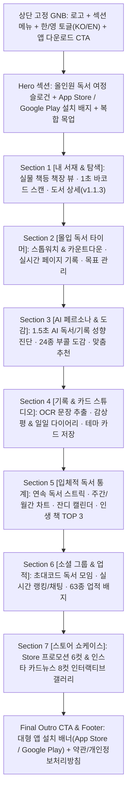

# 📖 BookTrack 공식 앱 소개 웹페이지 기획 및 디자인 명세서 (`앱소개.md`)

> **문서 목적**: 옵시디언 볼트(`ScreenInfo.md`, `store_image_gen.md`, `reading_personas_spec.md`, `achievements_guide.md`, `version_1.1.3.md`)의 화면 정의 및 실제 캡처본(`screen_captures/`)과 스토어 프로모션 디자인 에셋(`storeData/`)을 완벽히 분석하여, **노션(Notion) 스타일의 인터랙티브 제품 쇼케이스 레이아웃**과 **`storeData`의 소프트 라벤더-화이트 브랜드 테마**를 결합한 고전환율(High-Conversion) 앱 소개 웹페이지 기획서입니다.

---

## 1. 🔗 필수 앱 설치 링크 및 다운로드 전환(Conversion) 설계

웹페이지의 최우선 목표는 방문자에게 BookTrack의 핵심 가치를 직관적으로 전달하고 **즉각적인 앱 설치(App Store / Google Play)**로 연결하는 것입니다.

### 1.1 공식 스토어 설치 URL (필수 고정)
| 플랫폼 | 스토어 명칭 | 공식 다운로드 URL | 버튼 ID (HTML) |
| :--- | :--- | :--- | :--- |
| **iOS (iPhone / iPad)** | **Apple App Store** | `https://apps.apple.com/us/app/%EB%B6%81%ED%8A%B8%EB%9E%99/id6773334377` | `#hero-btn-ios`, `#cta-btn-ios`, `#nav-btn-ios` |
| **Android** | **Google Play Store** | `https://play.google.com/store/apps/details?id=com.cns.booktrack` | `#hero-btn-android`, `#cta-btn-android`, `#nav-btn-android` |

### 1.2 4중 다운로드 퍼널(Funnel) 배치 전략
1. **상단 고정 헤더 (Sticky GNB)**:
   - 스크롤 위치와 무관하게 우측 상단에 `[앱 다운로드]` 버튼을 상시 노출하며, 클릭 시 스토어 선택 드롭다운 또는 하단 다운로드 섹션으로 즉시 연결합니다.
2. **히어로 섹션 (First-View Dual Store Badges)**:
   - 페이지 진입 즉시 시선이 머무는 메인 타이틀 하단에 **App Store**와 **Google Play** 공식 배지 버튼을 나란히 배치합니다. (OS 구분 없이 통합 노출하여 접근성 극대화)
3. **모바일 플로팅 바 / PC QR 코드 지원**:
   - 모바일 웹 접속 시 화면 하단에 고정형 `[📖 북트랙 무료로 시작하기]` 플로팅 배너를 노출하고, 데스크톱(PC) 접속 시 스마트폰 카메라로 바로 스캔할 수 있는 스토어 QR 코드를 함께 제공합니다.
4. **하단 피날레 아웃트로 CTA (Outro Banner & Footer)**:
   - 모든 기능 탐색을 마친 최하단 영역에 `storeData/insta_carousel/08_Insta_Outro_CTA.png` 비주얼과 결합된 대형 다운로드 배너 및 푸터 직행 링크를 배치합니다.

---

## 2. 🎨 디자인 시스템 및 비주얼 테마 (`storeData` + Notion Layout)

### 2.1 브랜드 컬러 팔레트 (`storeData` 오리지널 테마 계승)
`storeData` 프로모션 이미지의 **밝고 감성적인 소프트 라벤더-화이트 파스텔 톤앤매너**와 **로얄 블루 포인트**를 웹페이지 전역 테마로 적용합니다.

| 구분 | 색상명 | HEX / CSS 값 | 적용 영역 |
| :--- | :--- | :--- | :--- |
| **Background Primary** | Soft Lavender White | `linear-gradient(180deg, #F6F7FC 0%, #EAEAF5 50%, #E2E3F0 100%)` | 히어로 배경, 주요 섹션 교차 배경, 쇼케이스 카드 |
| **Background Surface** | Pure Glass White | `rgba(255, 255, 255, 0.88)` + `backdrop-filter: blur(16px)` | 노션 스타일 기능 카드, 플로팅 콜아웃 배지, 상단 GNB |
| **Brand Primary** | Royal Book Blue | `#0A58CA` / `#1D4ED8` | 핵심 키워드 하이라이트, 활성 탭 버튼, 브랜드 배지 텍스트 |
| **Brand Secondary** | Bookmark Purple | `#6366F1` / `#7C3AED` | 3D 책갈피 데코레이션, AI 페르소나 배지, 그라데이션 포인트 |
| **Accent Streak** | Flame Amber | `#F59E0B` → `#EA580C` | 연속 독서 스트릭(Streak) 배너, 별점 및 마일스톤 강조 |
| **Text Primary** | Deep Navy Black | `#111827` | 메인 헤드라인 (`ExtraBold` 800), 섹션 대제목 |
| **Text Secondary** | Dark Slate Gray | `#4B5563` | 서브 카피 (`Medium/SemiBold`), 기능 상세 설명 본문 |
| **Border & Divider** | Cool Gray Border | `#CBD5E1` / `#E2E8F0` | 알약형 `[📖 북트랙]` 배지 테두리, 카드 보더 |

### 2.2 레이아웃 & 비주얼 연출 원칙
1. **노션(Notion) 스타일 제품 소개 레이아웃**:
   - 각 기능 섹션은 **`[상단 알약 배지 + 블랙&블루 투톤 헤드라인 + 한 줄 리드 문구]`** 아래에 **좌측 인터랙티브 기능 카드(탭 버튼 포함) + 우측 복합 디바이스 목업 쇼케이스**가 교차(Zig-Zag) 배치되는 구조로 설계합니다.
   - 요약이 필요한 보조 기능(24종 페르소나 도감, 63종 업적, 그룹 랭킹 등)은 **노션 Bento Grid(벤토 그리드)** 카드 레이아웃으로 한눈에 스캔 가능하게 구성합니다.
2. **`storeData` 복합 레이어링 목업 연출**:
   - 단순한 단일 스마트폰 나열을 지양하고, `storeData/android/v113_screenshots/`의 구도처럼 **[전면 메인 스크린 목업 + 후면 서브 스크린 레이어링 + 아이콘·말풍선이 결합된 화이트 플로팅 콜아웃 칩]**으로 입체감을 부여합니다.
3. **한/영 다국어(Localization) 동적 스왑 아키텍처**:
   - 상단 네비게이션 바에 `🌐 KO | EN` 언어 전환 버튼을 배치합니다.
   - `EN` 선택 시 페이지 내 모든 텍스트(`data-i18n`)가 영문으로 즉시 전환되며, 동시에 모든 화면 이미지(`src`)도 영문 스토어 에셋(`storeData/android/en/`, `storeData/ios/renewal_ios_image_en/`, `assets/images/android/*_en.*`)으로 동적 교체됩니다.

---

## 3. 📐 페이지 전체 구조 (Sitemap & Wireframe Flow)

---

## 4. 📱 섹션별 상세 기획 및 에셋 매핑 (`ScreenInfo` & `storeData` 연동)

---

### [Section 0] 상단 고정 헤더 (Sticky Navigation Bar)
- **구성 요소**:
  - **좌측 브랜드 영역**: 투명 배경 앱 로고(`storeData/app_logo_transparent.png`) + `BookTrack` 브랜드명
  - **중앙 퀵 내비게이션**: `내 서재` · `독서 타이머` · `AI 페르소나` · `감상 카드` · `독서 통계` · `독서 모임` · `쇼케이스`
  - **우측 액션 영역**:
    - 다국어 전환 토글 버튼: `🌐 한국어 / English` (클릭 시 전체 텍스트 및 한/영 스크린샷 즉시 전환)
    - 스토어 다운로드 CTA 버튼: `[앱 다운로드]` (클릭 시 iOS/Android 스토어 설치 영역으로 스크롤 또는 팝오버 노출)

---

### [Hero Section] 나만의 완벽한 독서 여정, 올인원 독서 앱 북트랙
- **디자인 레퍼런스**: `storeData/android/v113_screenshots/01_HomeScreen.png`, `storeData/insta_carousel/01_Insta_Hook_Home.png`
- **상단 브랜드 칩**: `북트랙`
- **메인 헤드라인**:
  - **(KO)**: 독서를 **기록하고**, **감상을** 남기고, **습관으로** 만드는 올인원 독서 앱 *(핵심 키워드 `#0A58CA` 로얄 블루 강조)*
  - **(EN)**: **Track** Your Reading, **Capture** Your Thoughts, Build a **Lifelong Habit**
- **필수 액션 버튼 (Dual Store CTA)**:
  - 🍎 **Download on the App Store**: `https://apps.apple.com/us/app/%EB%B6%81%ED%8A%B8%EB%9E%99/id6773334377`
  - ▶️ **GET IT ON Google Play**: `https://play.google.com/store/apps/details?id=com.cns.booktrack`
- **하단 핵심 가치 칩 (3종)**:
  - `📘 감성 실물 서재 & 타이머` · `✏️ 독서 기록` · `✨ AI 독서·기록 페르소나`
- **매핑 화면 및 이미지 경로**:
  - **메인 전면 목업**: `SCR-006` 홈 화면 (`screen_captures/03_home/SCR-006_HomeScreen.png`) — 4일 연속 독서 스트릭 배너, 최근 1주일 독서 기록 차트, 이달의 독서 목표 게이지
  - **좌측 후면 레이어 목업**: `SCR-007` 내 서재 책장 뷰 (`screen_captures/04_library/SCR-007_LibraryScreen.png`)
  - **스토어 복합 배너 에셋**:
    - (KO) `storeData/android/v113_screenshots/01_HomeScreen.png` / `storeData/ios/v113_screenshots/01_HomeScreen.png`
    - (EN) `storeData/android/en/ChatGPT Image 2026년 8월 25일 오후 05_11_24 (1).png`

---

### [Section 1] 내 서재 & 도서 탐색 — 아날로그 감성의 실물 책장과 1초 도서 등록
- **관련 화면 ID (`ScreenInfo.md`)**: `SCR-007` (내 서재), `SCR-008` (도서 검색 및 탐색), `SCR-009` (도서 상세 v1.1.3 개편), `MOD-001` (내 독서 정보 공유 모달), `MOD-002` (서재 도서 추가 위저드)
- **상단 배지**: `1️⃣ SMART LIBRARY & DISCOVERY`
- **메인 헤드라인**:
  - **(KO)**: 나만의 취향으로 채우는 **감성 실물 책장**과 **1초 도서 등록**
  - **(EN)**: Your Personal **Realistic Bookshelf** & **Instant Book Search**
- **서브 카피**:
  - **(KO)**: 읽고 싶은 책부터 완독한 책까지, 실제 책등(`sideCoverUrl`)이 꽂히는 2줄 원목 서가와 간편한 도서 검색으로 나만의 서재를 완성하세요.
- **핵심 기능 블록 (인터랙티브 탭 전환)**:
  1. **🪵 실측 책등 렌더링 책장 뷰 & 그리드 뷰 (`SCR-007`)**:
     - `[등록된 책]` / `[감상평]` 2대 상단 탭과 **책장 뷰(`BOOKSHELF`) ↔ 카드 그리드 뷰(`GRID`)** 즉시 전환 지원.
     - `전체` · `읽는 중` · `읽을 예정` · `완독` 상태별 필터링 칩 및 커스텀 책장 분류 제공.
     - **영구 독서 이력(`ReadingHistory`) 아키텍처**: 서재에서 도서를 정리(삭제)하더라도 그동안 쌓은 독서 기록과 통계, 완독 책장 표지는 영구 보존됩니다.
  2. **🔍 간편 도서 검색 & 단계별 추가 위저드 (`SCR-008`, `MOD-002`)**:
     - 알라딘, 네이버, 뉴욕타임즈(NYT) API 통합 검색 및 원터치 간편 등록.
     - **서재 추가 온보딩 위저드(`MOD-002`)**: 책을 담을 때 독서 상태(읽을 예정/읽는 중/완독), 독서 기간, 과거 총 독서 시간을 단계별로 손쉽게 기록.
  3. **📖 125% 확대 북 커버 & 도서 상세 대시보드 (`SCR-009`, `MOD-001` — v1.1.3 최신 개편)**:
     - 시원하게 확대한 125% 북 커버와 상시 노출되는 `[▶ 책 읽기]`, `[✍️ 기록하기]` 퀵 액션 버튼.
     - `[작품 정보]`(줄거리·YES24 구매 연동)와 **`[내 독서 정보]`(총 독서 시간, 완독률 게이지, 페이지당 소요 시간, 최근 7회 독서 흐름 막대 차트, 날짜별 캘린더)** 2대 탭 완벽 분리.
     - **내 독서 정보 옵션형 이미지 공유(`MOD-001`)**: 1회 평균 독서 시간·페이지당 소요 시간 표시 여부를 선택하여 외곽 여백 없는 투명 PNG 카드로 갤러리 저장 및 공유.
- **매핑 이미지 경로**:
  - 탭 1 (책장 뷰): `screen_captures/04_library/SCR-007_LibraryScreen.png`
  - 탭 2 (그리드/리스트 뷰): `assets/figma_images/sec1_list.png`
  - 탭 3 (도서 탐색): `screen_captures/05_search/SCR-008_SearchScreen.png`
  - 탭 4 (도서 상세 & 내 독서 정보 공유): `screen_captures/06_detail/SCR-009_DetailScreen.png`, `screen_captures/13_modals/MOD-001_DetailReadingInfoShareDialog.png`
  - 영문(EN) 스왑 에셋: `storeData/android/en/ChatGPT Image 2026년 8월 25일 오후 05_11_25 (3).png`, `assets/images/android/hero_library_en.jpeg`

---

### [Section 2] 집중 독서 타이머 — 오롯이 책에 몰입하는 시간과 루틴
- **관련 화면 ID (`ScreenInfo.md`)**: `SCR-010` (독서 타이머 화면), `SCR-012` (독서 목표 편집 화면)
- **디자인 레퍼런스**: `storeData/android/v113_screenshots/05_TimerScreen.png`, `storeData/renewal_android_ko/03_집중독서_타이머.png`, `storeData/insta_carousel/04_Insta_Timer.png`
- **상단 배지**: `2️⃣ IMMERSIVE READING TIMER`
- **메인 헤드라인**:
  - **(KO)**: 오롯이 책에 집중하는 **스마트 독서 타이머**
  - **(EN)**: Stay Fully Immersed with the **Smart Reading Timer**
- **서브 카피**:
  - **(KO)**: 스톱워치와 목표 카운트다운, 실시간 페이지 기록으로 매일의 독서 몰입 시간을 차곡차곡 쌓아보세요.
- **핵심 기능 블록 (3대 플로팅 콜아웃 + 인터랙티브 탭)**:
  1. **⏱️ 스톱워치 & 목표 카운트다운 듀얼 모드 (`SCR-010`)**:
     - 여유롭게 읽는 자유 측정 **스톱워치**와 목표 시간을 정해 집중력을 높이는 **카운트다운 타이머**를 원터치로 전환합니다.
     - 화면 가리기(절전 집중 모드) 및 백그라운드 시간 측정 안전 유지 기능을 지원합니다.
  2. **📖 실시간 페이지 & 퍼센트(%) 진도율 기록 (`SCR-010`)**:
     - 독서 종료 시 읽은 페이지 수 또는 진행률(%) 슬라이더를 입력하면 총 누적 독서 시간과 페이지당 평균 소요 시간이 자동 계산되어 로컬 DB 및 클라우드(Firestore)에 실시간 동기화됩니다.
     - 카운트다운 목표 달성 시 전용 축하 통계 카드(`CountdownStatsCard`)가 제공됩니다.
  3. **🎯 월간 & 연간 독서 목표 설계 (`SCR-012`)**:
     - 이달의 목표 권수, 목표 독서 시간, 목표 독서 일수 및 연간 목표 권수를 설정하고 '나의 다짐 한 줄 메모'와 함께 달성률 게이지를 관리합니다.
- **매핑 이미지 경로**:
  - 탭 1 (독서 타이머 & 내 독서 정보 복합 컷): `storeData/android/v113_screenshots/05_TimerScreen.png` (iOS: `storeData/ios/v113_screenshots/05_TimerScreen.png`)
  - 탭 2 (타이머 클린 단독 화면): `assets/figma_images/sec1_timer.png`
  - 탭 3 (독서 목표 설정): `screen_captures/09_insights/SCR-012_GoalEditScreen.png`, `assets/figma_images/sec1_goal.png`
  - 영문(EN) 스왑 에셋: `storeData/android/en/ChatGPT Image 2026년 8월 25일 오후 05_11_25 (3).png`, `assets/images/android/hero_timer_en.jpeg`

---

### [Section 3] AI 독서·기록 페르소나 & 24종 부콜(BookOwl) 도감 컬렉션
- **관련 화면 ID (`ScreenInfo.md`)**: `SCR-021` (내 정보 및 AI 리포트), `SCR-025` (독서 페르소나 24종 도감), `MOD-003` (독서 스타일 상세 및 공유 모달), `MOD-004` (독서 기록 스타일 상세 및 공유 모달)
- **디자인 레퍼런스**: `storeData/android/v113_screenshots/02_PersonaScreen.png`, `storeData/renewal_android_ko/02_AI독서분석_페르소나.png`, `storeData/insta_carousel/07_Insta_AI_Persona.png`
- **상단 배지**: `3️⃣ AI READING & RECORD PERSONA`
- **메인 헤드라인**:
  - **(KO)**: AI가 분석하는 **독서 & 기록 페르소나**와 **24종 도감 컬렉션**
  - **(EN)**: AI-Powered **Reading & Writing Personas** & **24 BookOwl Collection**
- **서브 카피**:
  - **(KO)**: 나의 독서 습관과 감상평 문체 진단부터, 읽고 기록할수록 해금되는 24종 부콜(BookOwl) 캐릭터 도감과 맞춤 도서 추천까지 만나보세요.
- **핵심 기능 블록**:
  1. **🦉 3대 영역 24종 독서 페르소나 도감 (`SCR-025`, `reading_personas_spec.md`)**:
     - 가짜 디폴트 데이터 없이 오직 사용자의 실측 데이터로만 해금되는 정직한 페르소나 시스템:
       - **홈 독서 성향 페르소나 (10종)**: *경계를 넘는 SF 탐험가, 지혜를 좇는 철학적 사색가, 경계를 넘나드는 잡식성 올라운더, 여러 세상을 넘나드는 병렬 독서가, 틈틈이 피어나는 데일리 루틴 리더* 등
       - **독서 기록 문체 페르소나 (9종)**: *감각적으로 순간을 수놓는 감성 아카이비스트, 본질을 찌르는 촌철살인 한줄 평론가, 심플 미니멀 요약가* 등
       - **주간 24시간 코어타임 페르소나 (5종)**: *고요한 아침의 사색가, 심야의 올빼미 독서가, 주말 몰입형 여행자* 등
  2. **⚡ 1.5초 초고속 AI 성향 분석 & 공유 카드 (`MOD-003`, `MOD-004` — v1.1.3 고도화)**:
     - 독서 스타일과 기록 스타일을 각각 독립된 초경량 AI 엔진으로 **1.5초 이내에 초고속 진단**하며, 화면을 이동하거나 백그라운드로 전환해도 중단 없이 완주 및 영구 캐싱됩니다.
     - 상징 아이템을 장착한 3D 부콜 캐릭터 일러스트와 AI 심층 선정 사유, 맞춤 코칭 팁을 여백 없는 고화질 카드로 저장·공유할 수 있습니다.
  3. **💡 내 서재 기반 AI 맞춤 도서 큐레이션 (`SCR-006`, `SCR-008`, `SCR-021`)**:
     - 내 서재의 선호 장르 비중(예: 소설 33%, 인문 25%)과 최근 독서 패턴을 분석하여 다음에 읽을 인생 책을 정교하게 추천합니다.
- **비주얼 쇼케이스 요소 (24종 부콜 아바타 마퀴/그리드 배너)**:
  - `persona/transparent/` 폴더 내 투명 배경 3D 부콜 캐릭터 에셋(`HM_G01_SF_EXPLORER.png`, `HM_P01_ALL_ROUNDER.png`, `HM_P02_PARALLEL_READER.png`, `RC_S03_EMOTIONAL_ARCHIVIST.png`, `ST_T01_NIGHT_OWL.png` 등)을 인터랙티브 캐릭터 쇼케이스 스트립으로 배치.
- **매핑 이미지 경로**:
  - 탭 1 (페르소나 상세 & 24종 도감 복합 컷): `storeData/android/v113_screenshots/02_PersonaScreen.png` (iOS: `storeData/ios/v113_screenshots/02_PersonaScreen.png`)
  - 탭 2 (24종 페르소나 도감 전체 화면): `screen_captures/10_social/SCR-025_PersonaCatalogScreen.png`
  - 탭 3 (독서 스타일 상세 모달 `MOD-003`): `screen_captures/13_modals/MOD-003_ReadingPersonaDetailDialog.png`, `assets/figma_images/sec2_persona.png`
  - 탭 4 (기록 스타일 상세 모달 `MOD-004`): `screen_captures/13_modals/MOD-004_RecordPersonaDetailDialog.png`, `assets/figma_images/sec3_record_style.png`
  - 탭 5 (AI 리포트 & 맞춤 도서 추천): `storeData/renewal_android_ko/02_AI독서분석_페르소나.png`, `assets/figma_images/sec4_recommend.png`
  - 영문(EN) 스왑 에셋: `storeData/android/en/ChatGPT Image 2026년 8월 25일 오후 05_11_25 (4).png`, `assets/images/android/hero_ai_report_en.jpeg`

---

### [Section 4] 독서 기록 & 감성 카드 스튜디오 — 마음에 남은 문장을 카드로 예쁘게
- **관련 화면 ID (`ScreenInfo.md`)**: `SCR-014` (독서 기록 피드), `SCR-015` (감상평 상세), `SCR-016` (다이어리 상세), `SCR-017` (감상평 에디터), `SCR-018` (다이어리 에디터), `SCR-019` (이미지 크롭), `SCR-020` (감상평 이미지 카드 저장 미리보기), `MOD-005` (다이어리 이미지 크롭 저장 모달), `MOD-009` (감상평 작성 가이드)
- **디자인 레퍼런스**: `storeData/android/v113_screenshots/03_RecordScreen.png`, `storeData/android/v113_screenshots/04_ReviewCardScreen.png`, `storeData/insta_carousel/05_Insta_Custom_Editor.png`, `storeData/insta_carousel/06_Insta_Reading_Record.png`
- **상단 배지**: `4️⃣ ARCHIVE & CUSTOM CARD STUDIO`
- **메인 헤드라인**:
  - **(KO)**: 독서의 모든 기록을 **한눈에 차곡차곡**, 마음에 남은 문장은 **카드로 예쁘게**
  - **(EN)**: All Your Reading Logs **in One Place**, Favorite Quotes **in Aesthetic Cards**
- **서브 카피**:
  - **(KO)**: 카메라 OCR 문장 스캔부터 감성 폰트·색상 조색 다이어리, 인스타그램 맞춤 비율(1:1, 4:5, 9:16) 리뷰 카드 제작까지 한 번에 완성하세요.
- **핵심 기능 블록**:
  1. **📅 통합 독서 기록 대시보드 & 북 넘김 뷰어 (`SCR-014`, `SCR-015`)**:
     - 작성한 다이어리와 감상평 개수를 한눈에 집계하고, 날짜별 독서 캘린더와 도서별 모아보기 필터링을 제공합니다.
     - 감상평 탭에서는 실제 책장을 넘기듯(`← 이전 장 | 1/26 | 다음 장 →`) 내 서평들을 감상할 수 있습니다.
  2. **📷 카메라 OCR 문장 자동 추출 & 블록형 에디터 (`SCR-017`, `MOD-009`)**:
     - 책 속 밑줄 친 구절을 카메라로 촬영하면 온디바이스 OCR이 텍스트로 즉시 추출합니다.
     - 0.5점 단위 별점 드래그, 다중 감정 태그(영감을 주는, 생각에 잠기는, 위로가 되는 등), 구조화된 생각 블록(나의 생각·감상·질문)으로 깊이 있는 서평을 남길 수 있습니다.
  3. **🎨 커스텀 다이어리 & 고해상도 감상 카드 스튜디오 (`SCR-018`, `SCR-019`, `SCR-020`, `MOD-005`)**:
     - 사진 첨부, 폰트 스타일·크기 조절, 글자색·박스색·배경 테마(단색/그라데이션/빈티지 페이퍼/모던 다크/미드나잇 블루)를 자유롭게 조색합니다.
     - **비율 프리셋 크롭(`SCR-019`, `MOD-005`)**: 원본, `1:1(정방형)`, `4:5(인스타 피드)`, `9:16(인스타 스토리)` 비율 선택 및 모서리 외곽 여백 없는 깔끔한 고해상도 이미지 저장을 지원합니다.
- **매핑 이미지 경로**:
  - 탭 1 (독서 기록 통합 & 서평 북뷰어 복합 컷): `storeData/ios/v113_screenshots/03_RecordScreen.png`
  - 탭 2 (다이어리 조색 에디터 & 리뷰 카드 복합 컷): `storeData/android/v113_screenshots/04_ReviewCardScreen.png` (iOS: `storeData/ios/v113_screenshots/04_ReviewCardScreen.png`)
  - 탭 3 (감상평 카드 테마 & 비율 미리보기 `SCR-020`): `screen_captures/08_record/SCR-020_ReviewSavePreviewScreen.png`, `assets/figma_images/sec5_card_custom.png`
  - 탭 4 (OCR 문장 추출 & 감정 태그 에디터 `SCR-017`): `screen_captures/08_record/SCR-017_EditorScreen.png`, `assets/figma_images/sec5_review_write.png`
  - 탭 5 (정밀 이미지 크롭 `SCR-019` & 다이어리 상세 `SCR-016`): `screen_captures/08_record/SCR-019_CropScreen.png`, `screen_captures/08_record/SCR-016_DiaryDetailScreen.png`
  - 영문(EN) 스왑 에셋: `storeData/android/en/08_reading_log_all.png`, `storeData/android/en/09_reading_diary.png`, `storeData/ios/renewal_ios_image_en/08_reading_log_all.png`, `storeData/ios/renewal_ios_image_en/09_reading_diary.png`

---

### [Section 5] 입체적 독서 통계 & 올타임 리포트 — 숫자와 차트로 보는 나의 독서 성장
- **관련 화면 ID (`ScreenInfo.md`)**: `SCR-011` (독서 통계 및 캘린더), `SCR-013` (역대 전체 독서 기록)
- **디자인 레퍼런스**: `storeData/android/v113_screenshots/06_InsightsScreen.png`, `storeData/insta_carousel/03_Insta_Statistics.png`, `storeData/insta_carousel/08_Insta_Outro_CTA.png`
- **상단 배지**: `5️⃣ READING INSIGHTS & ALL-TIME REPORT`
- **메인 헤드라인**:
  - **(KO)**: 숫자와 차트로 보는 **나만의 독서 통계**와 **인생 책 리포트**
  - **(EN)**: Visualize Your Growth with **Reading Analytics & All-Time Reports**
- **서브 카피**:
  - **(KO)**: 연속 독서 챌린지부터 24시간 집중 히트맵, 월간 실물 책등 결산 리포트, 나의 인생 책 TOP 3까지 한눈에 확인하세요.
- **핵심 기능 블록 (4대 뷰 스위처)**:
  1. **📚 월간 완독 실물 책등 서가 (`SCR-028`)**:
     - 한 달 동안 완독한 책들이 실제 책등 모양으로 서가에 나란히 꽂히는 인포그래픽 결산 리포트와 시간당 독서 페이스(p/h), 전월 대비 성장을 한눈에 비교합니다.
  2. **🔥 연속 독서 스트릭 챌린지 (`SCR-006`)**:
     - 매일 독서 루틴을 만들어주는 불꽃 스트릭 배너(`3일 달성` · `7일 달성` · `14일 도전` · `30일 마스터`)로 매일의 몰입 습관을 유지합니다.
  3. **⏰ 24시간 독서 패턴 블록 히트맵 (`SCR-027`)**:
     - 00시부터 23시까지 24개 시간대 히트맵으로 내가 가장 몰입하는 황금 코어타임과 요일별 독서 시간을 정밀 분석합니다.
  4. **🏆 역대 전체(All-Time) 독서 기록 & 인생 책 TOP 3 (`SCR-013`)**:
     - 앱 설치 이후 누적된 총 완독 권수, 누적 독서 시간, 완독 페이지, 작성 기록 수를 통합 집계하고, 가장 오랜 시간 몰입한 **나의 인생 책 TOP 3**와 **분야별 장르 도넛 차트**를 제공합니다.
- **매핑 이미지 경로**:
  - 뷰 1 (월간 실물 책등 결산 리포트): `screen_captures/09_insights/SCR-028_InsightsFinishedBookshelfView.png`
  - 뷰 2 (연속 독서 스트릭): `screen_captures/03_home/SCR-006_HomeScreen.png`
  - 뷰 3 (24시간 히트맵 & 코어타임 분석): `screen_captures/09_insights/SCR-027_InsightsPatternView.png`
  - 뷰 4 (역대 전체 독서 기록 & 인생 책 TOP 3): `screen_captures/09_insights/SCR-013_AllTimeReadingRecordScreen.png`
  - 영문(EN) 스왑 에셋: `assets/images/android/hero_home_en.jpeg`, `storeData/android/en/ChatGPT Image 2026년 8월 25일 오후 05_11_26 (6).png`

---

### [Section 6] 함께 읽는 독서 모임 & 63종 업적 챌린지 (Bento Grid 섹션)
- **관련 화면 ID (`ScreenInfo.md`)**: `SCR-022` (업적 및 배지 화면), `SCR-023` (독서 그룹 및 랭킹 화면), `SCR-024` (그룹원 서재 구경 화면)
- **디자인 레퍼런스**: `storeData/renewal_android_ko/06_독서목표_업적달성.png`, `achievements_guide.md`
- **상단 배지**: `6️⃣ SOCIAL READING GROUP & 63 ACHIEVEMENTS`
- **메인 헤드라인**:
  - **(KO)**: 친구와 함께 읽는 **실시간 독서 모임**과 **63종 업적 컬렉션**
  - **(EN)**: Read Together in **Live Book Clubs** & Unlock **63 Achievements**
- **핵심 기능 블록 (노션 스타일 2열 벤토 그리드)**:
  1. **👥 실시간 독서 그룹 & 동료 서재 구경 (`SCR-023`, `SCR-024`)**:
     - 간편하게 독서 모임을 만들고 참여할 수 있습니다.
     - 그룹별 **주간·월간·누적 독서 시간 실시간 랭킹 리더보드**와 실시간 그룹 채팅 피드를 지원합니다.
     - 그룹원의 프로필을 탭하여 **동료의 소장 서재를 구경(`SCR-024`)**하고, 마음에 드는 책을 원클릭으로 `[내 서재에 담기]` 할 수 있습니다.
  2. **🏅 7개 카테고리 63종 업적 & 6대 티어 배지 (`SCR-022`)**:
     - 독서량(10종), 독서 시간(9종), 독서 습관(9종), 목표 달성(6종), 기록가(9종), 탐험가(4종), 소셜 및 히든 이스터에그(16종)까지 총 **63개의 도전 과제**를 제공합니다.
     - **브론즈 · 실버 · 골드 · 플래티넘 · 다이아 · 레전드** 6단계 티어 배지와 조건 달성 즉시 어느 화면에서든 실시간 축하 스낵바(`🏆 업적을 달성했어요!`)가 노출되어 독서 동기부여를 극대화합니다.
- **매핑 이미지 경로**:
  - 좌측 카드 (독서 그룹 랭킹 & 동료 서재): `screen_captures/11_group/SCR-023_GroupScreen.png`, `screen_captures/11_group/SCR-024_MemberLibraryScreen.png`
  - 우측 카드 (63종 업적 도감): `screen_captures/10_social/SCR-022_AchievementScreen.png`, `storeData/renewal_android_ko/06_독서목표_업적달성.png`
  - 영문(EN) 스왑 에셋: `storeData/android/en/ChatGPT Image 2026년 8월 25일 오후 05_11_27 (8).png`, `assets/images/android/achievements.jpeg`

---

### [Section 7] 공식 스토어 프로모션 & 카드뉴스 쇼케이스 (`storeData` 갤러리)
- **기획 의도**: `storeData`에 구축된 고퀄리티 스토어 프로모션 그래픽과 인스타그램 카드뉴스 에셋을 방문자가 좌우 슬라이드 캐러셀로 감상할 수 있는 비주얼 갤러리 섹션입니다.
- **서브 탭 구성**:
  1. **탭 A — 공식 스토어 하이라이트 (`storeData/android/v113_screenshots/` & `storeData/ios/v113_screenshots/`)**:
     - `01_HomeScreen.png`: 독서를 기록하고 감상을 남기고 습관으로 만드는 앱
     - `02_PersonaScreen.png`: AI가 분석하는 독서 & 기록 페르소나 (24종 도감)
     - `03_RecordScreen.png`: 독서의 모든 기록을 한눈에 차곡차곡 (`storeData/ios/v113_screenshots/03_RecordScreen.png` 클린본 활용)
     - `04_ReviewCardScreen.png`: 마음에 남은 문장은 카드로 예쁘게
     - `05_TimerScreen.png`: 오롯이 책에 집중하는 독서 타이머
     - `06_InsightsScreen.png`: 숫자와 차트로 보는 나만의 독서 통계
  2. **탭 B — 한눈에 보는 북트랙 스토리 (`storeData/insta_carousel/01 ~ 08`)**:
     - `01_Insta_Hook_Home.png` ~ `08_Insta_Outro_CTA.png` (8장 정방형/세로형 스토리텔링 카드뉴스 슬라이더)

---

### [Section 8] Final Outro CTA & Footer (하단 앱 설치 배너 및 공식 정보)
- **디자인 레퍼런스**: `storeData/insta_carousel/08_Insta_Outro_CTA.png`
- **헤드라인**:
  - **(KO)**: 올해는 북트랙과 함께 **평생 가는 독서 습관**을 시작하세요
  - **(EN)**: Start Your **Lifelong Reading Habit** with BookTrack Today
- **서브 카피**:
  - **(KO)**: 지금 App Store와 Google Play에서 **'북트랙'**을 다운로드하고, 나만의 감성 서재와 인생 책 TOP 3를 무료로 만들어 보세요!
  - **(EN)**: Download **BookTrack** on the App Store and Google Play for free and build your personal library today!
- **필수 스토어 설치 버튼 (대형 배지 2종 + QR 코드)**:
  - 🍎 **App Store에서 다운로드**: `https://apps.apple.com/us/app/%EB%B6%81%ED%8A%B8%EB%9E%99/id6773334377`
  - ▶️ **Google Play에서 다운로드**: `https://play.google.com/store/apps/details?id=com.cns.booktrack`
- **푸터 (Footer) 구성**:
  - 브랜드 정보: `BookTrack (북트랙) | v1.1.3`
  - 법적 고지 및 고객 지원 링크:
    - [개인정보 처리방침 (`privacy_policy.md`)](privacy_policy.md)
    - [서비스 이용약관 (`terms_of_service.md`)](terms_of_service.md)

---

## 5. 🗂️ `ScreenInfo.md` & `storeData` 전체 에셋 경로 매핑 총괄표

웹페이지 구현 시 참조할 화면 ID별 실기기 캡처본 및 스토어 프로모션 이미지의 전체 경로 매핑입니다.

| 화면/에셋 ID | 화면/컷 명칭 | 웹페이지 배치 섹션 | 한국어(KO) 에셋 경로 | 영어(EN) 전환 시 에셋 경로 |
| :--- | :--- | :--- | :--- | :--- |
| **STORE-01** | 올인원 독서 홈 & 서재 | Hero / Section 7 | `storeData/android/v113_screenshots/01_HomeScreen.png` | `storeData/android/en/ChatGPT Image 2026년 8월 25일 오후 05_11_24 (1).png` |
| **STORE-02** | AI 독서·기록 페르소나 | Section 3 / Section 7 | `storeData/android/v113_screenshots/02_PersonaScreen.png` | `storeData/android/en/ChatGPT Image 2026년 8월 25일 오후 05_11_25 (4).png` |
| **STORE-03** | 독서 기록 & 서평 피드 | Section 4 / Section 7 | `storeData/ios/v113_screenshots/03_RecordScreen.png` | `storeData/android/en/08_reading_log_all.png` |
| **STORE-04** | 문장 스크랩 & 생각 카드 | Section 4 / Section 7 | `storeData/android/v113_screenshots/04_ReviewCardScreen.png` | `storeData/android/en/09_reading_diary.png` |
| **STORE-05** | 집중 독서 타이머 | Section 2 / Section 7 | `storeData/android/v113_screenshots/05_TimerScreen.png` | `storeData/android/en/ChatGPT Image 2026년 8월 25일 오후 05_11_25 (3).png` |
| **STORE-06** | 입체적 독서 통계 | Section 5 / Section 7 | `storeData/android/v113_screenshots/06_InsightsScreen.png` | `storeData/android/en/ChatGPT Image 2026년 8월 25일 오후 05_11_26 (6).png` |
| **SCR-006** | 메인 홈 화면 | Hero | `screen_captures/03_home/SCR-006_HomeScreen.png` | `assets/images/android/hero_home_en.jpeg` |
| **SCR-007** | 내 서재 (책장/그리드) | Section 1 | `assets/figma_images/sec1_bookshelf.png` / `screen_captures/04_library/SCR-007_LibraryScreen.png` | `assets/images/android/hero_library_en.jpeg` |
| **SCR-008** | 도서 검색 & 바코드 | Section 1 | `screen_captures/05_search/SCR-008_SearchScreen.png` | `assets/images/android/hero_search_en.jpeg` |
| **SCR-009** | 도서 상세 (v1.1.3) | Section 1 | `screen_captures/06_detail/SCR-009_DetailScreen.png` | `screen_captures/06_detail/SCR-009_DetailScreen.png` |
| **MOD-001** | 내 독서 정보 공유 모달 | Section 1 | `screen_captures/13_modals/MOD-001_DetailReadingInfoShareDialog.png` | `screen_captures/13_modals/MOD-001_DetailReadingInfoShareDialog.png` |
| **MOD-002** | 서재 추가 위저드 모달 | Section 1 | `screen_captures/13_modals/MOD-002_AddToLibraryWizardDialog.png` | `screen_captures/13_modals/MOD-002_AddToLibraryWizardDialog.png` |
| **SCR-010** | 독서 타이머 (클린본) | Section 2 | `assets/figma_images/sec1_timer.png` | `assets/images/android/hero_timer_en.jpeg` |
| **SCR-011** | 독서 통계 & 인사이트 | Section 2 | `screen_captures/09_insights/SCR-011_InsightsScreen.png` | `storeData/android/en/ChatGPT Image 2026년 8월 25일 오후 05_11_25 (2).png` |
| **SCR-012** | 독서 목표 편집 | Section 2 | `screen_captures/09_insights/SCR-012_GoalEditScreen.png` | `screen_captures/09_insights/SCR-012_GoalEditScreen.png` |
| **SCR-025** | 페르소나 24종 도감 | Section 3 | `screen_captures/10_social/SCR-025_PersonaCatalogScreen.png` | `assets/images/android/hero_ai_report_en.jpeg` |
| **MOD-003** | 독서 스타일 상세 모달 | Section 3 | `screen_captures/13_modals/MOD-003_ReadingPersonaDetailDialog.png` | `assets/images/android/hero_ai_report_en.jpeg` |
| **MOD-004** | 기록 스타일 상세 모달 | Section 3 | `screen_captures/13_modals/MOD-004_RecordPersonaDetailDialog.png` | `assets/images/android/spotlight_dashboard_en.png` |
| **SCR-014** | 독서 기록 통합 피드 | Section 4 | `screen_captures/08_record/SCR-014_ReviewScreen.png` | `storeData/android/en/08_reading_log_all.png` |
| **SCR-017** | 감상평 & OCR 에디터 | Section 4 | `screen_captures/08_record/SCR-017_EditorScreen.png` | `assets/images/android/hero_review_save_en.jpeg` |
| **SCR-018** | 일일 독서 다이어리 | Section 4 | `screen_captures/08_record/SCR-018_DiaryEditorScreen.png` | `assets/images/android/spotlight_diary_en.png` |
| **SCR-019** | 정밀 이미지 크롭 | Section 4 | `screen_captures/08_record/SCR-019_CropScreen.png` | `screen_captures/08_record/SCR-019_CropScreen.png` |
| **SCR-020** | 감상평 카드 스튜디오 | Section 4 | `screen_captures/08_record/SCR-020_ReviewSavePreviewScreen.png` | `assets/images/android/spotlight_card_custom.jpeg` |
| **SCR-028** | 완독한 도서들(월간 책등 서가) | Section 5 | `screen_captures/09_insights/SCR-028_InsightsFinishedBookshelfView.png` | `screen_captures/09_insights/SCR-028_InsightsFinishedBookshelfView.png` |
| **SCR-013** | 역대 전체 독서 기록 | Section 5 | `screen_captures/09_insights/SCR-013_AllTimeReadingRecordScreen.png` | `screen_captures/09_insights/SCR-013_AllTimeReadingRecordScreen.png` |
| **SCR-022** | 63종 업적 및 배지 | Section 6 | `screen_captures/10_social/SCR-022_AchievementScreen.png` | `assets/images/android/achievements.jpeg` |
| **SCR-023** | 실시간 독서 그룹/랭킹 | Section 6 | `screen_captures/11_group/SCR-023_GroupScreen.png` | `screen_captures/11_group/SCR-023_GroupScreen.png` |
| **SCR-024** | 그룹원 서재 구경 | Section 6 | `screen_captures/11_group/SCR-024_MemberLibraryScreen.png` | `screen_captures/11_group/SCR-024_MemberLibraryScreen.png` |

---

## 6. ✅ 웹 디자인 품질 및 클린 검수 원칙 (Quality Assurance)

1. **광고 배너 Zero 정책**:
   - 웹페이지에 노출되는 모든 단독 스크린샷 및 스토어 복합 이미지에서 하단 테스트 광고/외부 배너가 노출되지 않는 클린 에셋만 사용합니다. (예: 독서 기록 스토어 컷은 하단 광고가 없는 `storeData/ios/v113_screenshots/03_RecordScreen.png` 또는 클린 처리된 `sec3_record_dashboard.png` 사용)
2. **화면-설명 1:1 정합성 보장**:
   - 각 기능 탭 클릭 시 텍스트가 설명하는 실제 화면(책장 뷰, 바코드 스캔, 도서 상세 내 독서 정보, 타이머, 24종 페르소나 도감, 카드 크롭/테마 에디터, 월간 책등 리포트, 올타임 TOP 3, 독서 그룹)이 정확히 매칭되어 표시됩니다.
3. **반응형 & 크로스 플랫폼 호환성**:
   - 데스크톱(1440px+), 태블릿(768px~1024px), 모바일(375px~) 전 해상도에서 스토어 설치 버튼과 목업 화면이 깨짐 없이 최적화된 비율로 렌더링됩니다.

